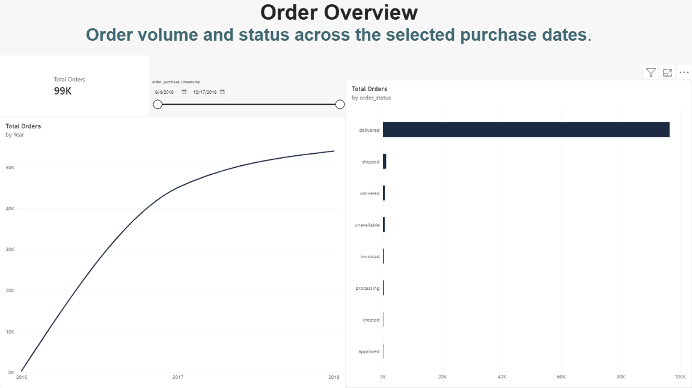
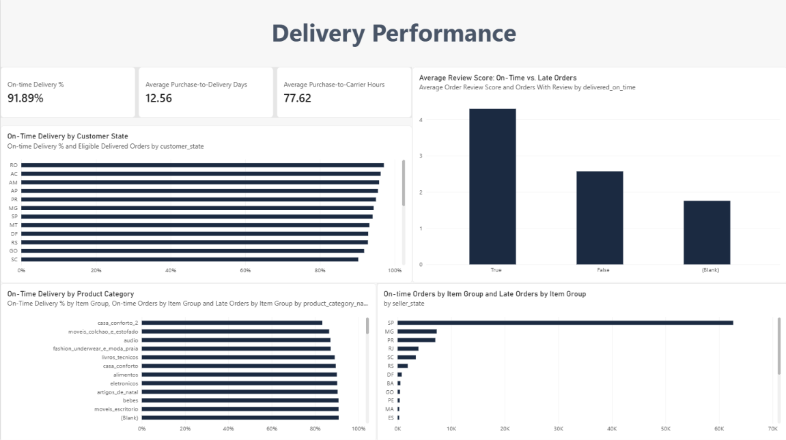
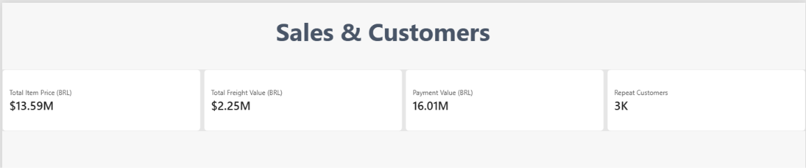
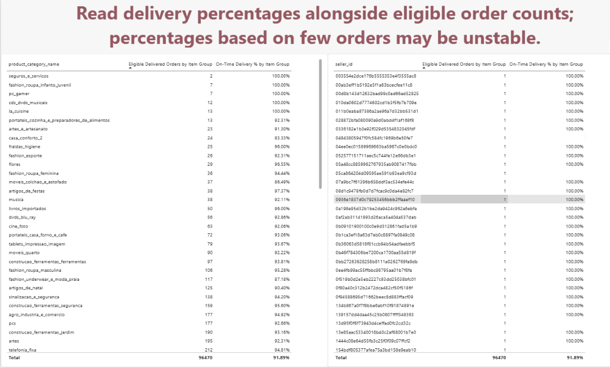

# Olist Marketplace Analysis

## Project introduction

Olist is a Brazilian online marketplace that connects customers with independent sellers. This project uses Olist order data to explore how the marketplace is performing: how many orders it receives, how quickly orders are delivered, whether deliveries meet their estimates, and how customers review their experience.

The goal was to follow a simple analytics workflow: inspect the CSV files, load the source data into PostgreSQL, prepare it for analysis with SQL, and build a Power BI report around practical business questions. The dataset covers orders from 2016 to 2018.

## Source CSV files

Eight CSV files were loaded into PostgreSQL. The source CSVs are not included in this repository; the geolocation file was not loaded or used in this version of the project.

| CSV file | Rows loaded | What it contains |
|---|---:|---|
| `olist_customers_dataset.csv` | 99,441 | Customer records, including location and customer identifiers. `customer_unique_id` is used to identify repeat customers. |
| `olist_orders_dataset.csv` | 99,441 | Order status and purchase, approval, delivery, and estimated-delivery timestamps. |
| `olist_order_items_dataset.csv` | 112,650 | Products sold in each order, seller, item price, freight value, and shipping limit date. |
| `olist_order_payments_dataset.csv` | 103,886 | Payment records, including payment method, installments, and amount. An order may have more than one payment record. |
| `olist_order_reviews_dataset.csv` | 99,224 | Review scores, comments, and review timestamps. An order may have multiple review rows, and review IDs can repeat across orders. |
| `olist_products_dataset.csv` | 32,951 | Product records and Portuguese product category names. |
| `olist_sellers_dataset.csv` | 3,095 | Seller records and seller locations. |
| `product_category_name_translation.csv` | 71 | Portuguese-to-English product category names. |
| `olist_geolocation_dataset.csv` | Not loaded | ZIP-code prefix coordinates and location data. This file was left out of the analysis. |

## Business questions

The report is designed to help investigate these questions:

- How many orders are in each status?
- How does order volume change over time?
- How long do orders take from purchase to carrier handoff and customer delivery?
- Among eligible delivered orders, what share arrived on or before the estimated date?
- How does delivery performance vary by customer state, seller state, or product category?
- How do review scores differ between on-time and late delivered orders?
- How do item price, freight value, and payment value compare?
- How many customers place repeat orders, using the correct customer identifier?
- Are any sellers or categories too small for a fair comparison?

## What I did

1. **Inspected and loaded the data.** I used Python and pandas to preview the CSV files, then loaded the eight analysis files into PostgreSQL as raw Bronze tables.
2. **Checked data quality.** SQL checks compared row counts, looked for missing order dates and duplicate keys, and checked that order items, products, sellers, and customers matched across tables. These checks also helped identify where missing dates, repeated review IDs, or absent review/payment records needed careful handling.
3. **Built the Silver layer.** I trimmed text fields, treated empty strings as missing values, converted analysis fields such as dates and amounts to suitable types, and added keys where the data supported them.
4. **Built the Gold layer.** I created an order-level fact table, an order-item-level fact table, and order-level payment and review summaries. The summaries help avoid multiplying order rows when joining payment or review records. I also created an order-experience view for reporting.
5. **Built the Power BI report.** The report has pages for Order Overview, Delivery Performance, Sales and Customers, and Sample Size Check. It includes charts and measures for order volume, delivery speed and reliability, state and category comparisons, review scores, item and payment amounts, repeat customers, and sample sizes.

For on-time delivery, an order is eligible only when it is marked delivered and has both an actual customer-delivery date and an estimated-delivery date. It is counted as on time when the actual date is on or before the estimated date. Delivery percentages should be read alongside their eligible-order counts, especially for sellers and categories with very few orders.

## Dashboard screenshots

### Order Overview

### Delivery Performance

### Sales and Customers

### Sample Size Check

## Project files

- Source CSV data is excluded from this repository.
- `sql/01_schema.sql` — creates the Bronze, Silver, and Gold schemas.
- `sql/02_data_check.sql` — data quality checks.
- `sql/03_bronze_to_silver_table.sql` — creates typed Silver tables from Bronze.
- `sql/04_silver_to_gold_table.sql` — creates Gold reporting tables and summaries.
- `Dashboard/Olist_Dashboard.pbix` — Power BI report.
- `image/` — dashboard screenshots.

## Tools

Python and pandas, PostgreSQL, pgAdmin, SQL, and Microsoft Power BI.
